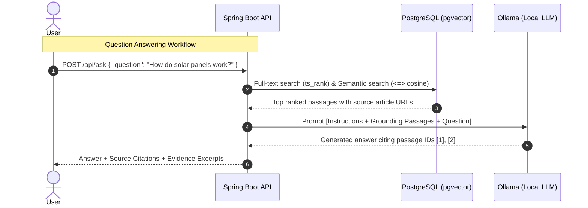

# Askepedia Architecture & Design

This document details the architectural decisions, component responsibilities, and system design for **Askepedia**.

---

## 1. System Components

### 1.1 Backend Service (`backend/`)
- **Framework:** Spring Boot 3.4.x on Java 21/25.
- **REST Layer (`controller`):** Exposes clean JSON endpoints for article inspection, keyword search, semantic search, and RAG question answering.
- **Data Transfer Layer (`dto`):** Strongly typed Java records for request inputs and response payloads with Bean Validation (`jakarta.validation`).
- **Domain Layer (`entity`):** Maps directly to persistent storage models (`Article`, `Passage`).
- **Persistence Layer (`dao`):** Data Access Objects managing SQL queries, migrations, and vector similarity operations.
- **Orchestration Layer (`service`):** Contains business logic for external Wikipedia API fetching, passage normalization/tokenization, vector generation, and local LLM prompt construction.

### 1.2 Data Storage (`PostgreSQL + pgvector`)
- **`wiki_article` Table:** Primary storage of ingested Wikipedia articles, canonical URLs, and full raw text.
- **`wiki_passage` Table:** Granular text passages chunked by paragraphs/token count, with `tsvector` column for full-text search and `vector` column for semantic embeddings.

### 1.3 Local AI Inference Engine (`Ollama`)
- **Chat/Completion Model:** Runs locally on localhost:11434 (e.g., `llama3.2:1b` or `phi3:mini`).
- **Embedding Model:** Runs locally for vector generation (e.g., `nomic-embed-text` with 768 dimensions).

---

## 2. Ingestion & Retrieval Workflows

